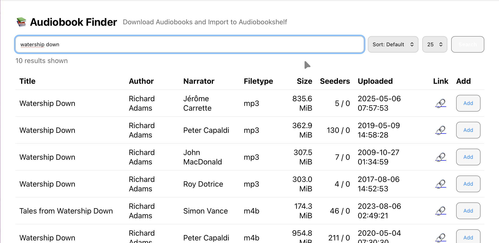
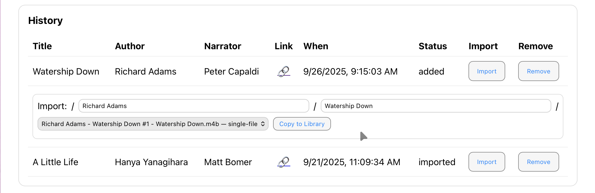

# MAM Book Finder

A lightweight web app + API to quickly search MyAnonamouse for audiobooks and ebooks, add them to qBittorrent, and import completed downloads: audiobooks into your [Audiobookshelf](https://www.audiobookshelf.org/) library, ebooks into your ebook library's import folder.





## Features

- **Search MAM** for audiobooks, ebooks, or both, by title, author, narrator or series  
- **Versions grouped by book**: the same book's m4b/mp3 or epub/pdf uploads share one row, so you pick the one you want (audiobooks with different narrators stay separate)  
- **One-click add to qBittorrent**, with separate categories and tags for audiobooks and ebooks  
- **Wishlist** of saved searches: re-check them with one tap (or, if you turn it on, automatically every few days), review new uploads, and get an ntfy notification when something new matches  
- **History view** of all books you've added  
- **Inline import tool**: audiobooks are copied or hard-linked into your Audiobookshelf library; ebooks are copied into your ebook library's import folder, and you choose which formats  
- Minimal, fast UI that works on desktop and mobile
- ZERO AUTHENTICATION (*Please* don't put this on the open internet. Tailscale or a Cloudflare Tunnel with Cloudflare Access might be good options.)
- Spouse tested and approved

## MAM rules and your account

This app only uses endpoints listed in MAM's API Documentation: the JSON torrent search (`/tor/js/loadSearchJSONbasic.php`) and the torrent download (`/tor/download.php`). It authenticates with a `mam_id` cookie you generate in MAM's Preferences → Security, and nothing else. It never asks for, stores or uses your MAM username or password, never logs in for you, and never fetches or scrapes MAM web pages. It identifies itself honestly as `mam-audiofinder/<version>` and stops on any authentication or rate-limit error instead of retrying.

You are still responsible for everything done under your account. Read MAM's rule 1.7 (Bots, Automation, and Scraping) before using this or any other tool with MAM. Details of how the app enforces this are in [`docs/MAM_COMPLIANCE.md`](docs/MAM_COMPLIANCE.md).

## Requirements

- qBittorrent with WebUI enabled  
- A valid MAM `mam_id` session cookie (Preferences → Security; ASN-locked recommended)  
- Docker & Docker Compose

## Because You'll Ask

***Why build this*** instead of using Readarr or one of its revivals, forks, or related projects?
- This uses the MAM API directly, not just for finding books but also for metadata. It doesn't rely on any other systems or databases. This is great for me because when a book shows up in my search results I KNOW I can download it, and I know the metadata like narrator and format will be accurate.
- I wanted something I could use from my phone that would be as fast as I could make it. This is very fast.
- This also keeps things dead simple. There's no queue, no requests, no ranking of multiple sources, no usenet, no RSS. Just search, download, and import to library.


## Quick Start

This repository includes a `docker-compose.yml` for Docker users. The usual flow is:

1. Clone this repository and `cd` into it:
   ```bash
   git clone https://github.com/raygan/mam-audiofinder.git
   cd mam-audiofinder
   ```
2. Copy `.env.example` → `.env` and fill in the required **env-only** values:
   - App port and host paths (`APP_PORT`, `DATA_DIR`, and optionally `MEDIA_ROOT` if you use the single media mount for hard links)
   - Container user/permissions (`PUID`, `PGID`, `UMASK`)
   - You can either set MAM/qB details here (`MAM_COOKIE`, `QB_URL`, `QB_USER`, `QB_PASS`) or leave them commented out and fill them in later via the web setup UI.
3. (Optional) I reccomend mounting a single Docker volume (MEDIA\_ROOT, mounted as /media) that contains both your qBittorrent downloads AND your Audiobookshelf library, to allow for hard linking insteaed of copying between the two. If you prefer separate mounts instead of a single `MEDIA_ROOT`, adjust the `volumes` section in `docker-compose.yml` as shown in the storage examples below, and set `DL_DIR` / `LIB_DIR` in `.env` to match.
4. Start the container with Docker Compose:
   ```bash
   docker compose up -d
   ```
5. Visit [http://localhost:8008](http://localhost:8008) (or your mapped port). On first run, you should land on `/setup` to configure MAM, qBittorrent, and library paths.

## Wishlist

A search that finds nothing today doesn't have to be lost. Save it, and the app can check it again later and tell you when a new upload matches.

- **Saving:** run a search, then press **☆ Save to wishlist** (under the results, or on "No results"). Saving doesn't contact MAM. The results already on screen count as seen, so only later uploads are reported.
- **Checking:** on the **Wishlist** page (link at the top of the search page), **Check now** runs one normal MAM search for that item, limited to torrents uploaded since you saved it.
- **What counts as a new match:** a result you haven't seen for that item, that isn't already in your History, and that MAM doesn't mark as snatched by you. Optional per-item filters (formats, minimum seeders, words to exclude, language) narrow it further.
- **Reviewing:** matches are listed under each item with **Add** and **Dismiss**. Adding a match marks the item done. For an item saved with **Both**, it's done once you've added both an audiobook and an ebook.
- **Notifications:** set a notification URL on the Setup page (ntfy by default, or a generic JSON webhook) to be told about new matches. Notifications never include your cookie or download links.
- **Tip:** MAM's search understands alternatives, so a saved search like `warlock (5|five)` catches both spellings.

### Automatic re-checks (off by default)

The scheduler re-checks saved searches for you. **It's off until you set `WISHLIST_SCHEDULER_ENABLED=true`.** Automating anything on MAM is your responsibility under rule 1.7, so read it first, and consider asking MAM staff what frequency they're comfortable with. When it's on, it stays conservative:

- one MAM search at a time, with a random 30–90 second gap between searches (never less than 30);
- each item checked about every 3 days (`WISHLIST_INTERVAL_HOURS`, with some random jitter);
- at most 20 wishlist searches per rolling 24 hours (`WISHLIST_MAX_REQUESTS_PER_DAY`), counting your manual **Check now** presses;
- on any problem from MAM (cookie rejected, rate limited, anything unexpected), it **stops all automatic checks**, notifies you once, and waits for you to press **Resume** on the Wishlist page. Nothing is retried.

Per item, **When found** can be set to **Auto-grab**: a scheduled check then adds the best new match (your preferred format first, then most seeders) to qBittorrent and notifies you. The default is **Notify me**, because auto-grabbing spends ratio without you deciding.

The scheduler runs inside the app, so run a **single** app process. The provided Dockerfile already does.

## Ebooks

Most ebook servers can watch an import folder and add whatever appears there. Ebook import copies the files you choose into that folder. Your ebook server picks them up and handles metadata and organisation, so the app doesn't create Author/Title folders for ebooks.

Set `EBOOK_INGEST_DIR` to that folder's path **inside this container**, either in `.env` or on the Setup page. For example, on Unraid with the default single mount `MEDIA_ROOT=/mnt/user/media` (mounted at `/media`), an import folder at `/mnt/user/media/books/import/` on the host becomes:

```env
EBOOK_INGEST_DIR=/media/books/import
```

The folder must already exist and be writable by the container's user (`PUID`/`PGID`, e.g. 99:100 on Unraid). The app checks this on startup and when you save Setup, and shows any problem on the main page.

How ebook import works:

- **Always copied, never hardlinked or moved.** Ingest tools commonly rewrite or delete the files they process. A hardlinked file that gets rewritten (for example, metadata embedded into an EPUB) corrupts the torrent you're seeding, and a moved file stops seeding. MAM is ratio-based, so this setting is deliberately not configurable.
- **You choose the formats.** When a torrent holds several formats of a book (e.g. `book.epub` and `book.pdf`), Import shows a checkbox for each, with the preferred format ticked (`EBOOK_FORMAT_PREFERENCE`, default `epub,azw3,mobi,pdf`). Covers, `.nfo` and other non-book files are never copied.
- **Your ebook server never sees half a file.** Each file is written under a hidden `.partial` name and renamed into place when complete. A name that's already taken becomes `book (2).epub`.

**Audiobooks and hardlinks:** `IMPORT_MODE=link` is only safe if Audiobookshelf is **not** set to embed metadata into your audio files. Embedding rewrites the file, and with a hardlink that also changes the copy you're seeding. Use `IMPORT_MODE=copy` if you embed metadata.

## Environment Variables

| Variable               | Description                                                                 |
|------------------------|-----------------------------------------------------------------------------|
| `MAM_COOKIE`           | Your MAM `mam_id` cookie value (use an ASN-locked session). Only `mam_id` is sent; any other cookies pasted are ignored |
| `QB_URL`               | qBittorrent WebUI URL (e.g. `http://qbittorrent:8080`)                      |
| `QB_USER`              | qBittorrent WebUI username                                                  |
| `QB_PASS`              | qBittorrent WebUI password                                                  |
| `APP_PORT`             | Host port that exposes the app’s web UI (used in `docker-compose.yml`)     |
| `MEDIA_ROOT`           | Host path mounted at `/media` inside the container (often a root that contains qB downloads and/or Audiobookshelf library; single filesystem recommended for hardlinks) |
| `DATA_DIR`             | Host path where this app stores its state (e.g. SQLite DB)                  |
| `DL_DIR`               | In-container path for qBittorrent downloads (default `/media/torrents`)     |
| `LIB_DIR`              | In-container path for Audiobookshelf library (default `/media/audiobookshelf`) |
| `IMPORT_MODE`          | Audiobooks only: `link`, `copy`, or `move` (default `link`). See the hardlink note above. Ebooks are always copied |
| `EBOOK_INGEST_DIR`     | In-container path of your ebook library's import folder, e.g. `/media/books/import`. Ebook import is unavailable until set |
| `EBOOK_FORMAT_PREFERENCE` | Which ebook format is pre-ticked at import (default `epub,azw3,mobi,pdf`); you can still tick any format |
| `NOTIFY_WEBHOOK_URL`   | Where to send notifications: your ntfy topic URL (e.g. `https://ntfy.example.com/books`) or another webhook. Empty = none. Never receives your cookie or download links |
| `NOTIFY_FORMAT`        | `ntfy` (default) or `json` (generic webhook, e.g. Home Assistant) |
| `NOTIFY_TOKEN`         | Optional ntfy access token (sent as a Bearer token) |
| `NOTIFY_CLICK_URL`     | Optional link opened when a notification is tapped, e.g. this app's `/wishlist/view` |
| `NOTIFY_ON_IMPORT`     | Also notify when an import finishes (default `false`) |
| `NOTIFY_BODY_TEMPLATE` | `json` format only: custom body using `{{event}}`, `{{title}}`, `{{message}}`, `{{click}}` |
| `WISHLIST_SCHEDULER_ENABLED` | Automatic re-checks of saved searches (default `false`). Off until you turn it on; see "Wishlist" below. Requires a single app worker |
| `WISHLIST_DELAY_MIN_SECONDS` / `WISHLIST_DELAY_MAX_SECONDS` | Random gap between scheduled MAM searches (default 30–90; never below 30) |
| `WISHLIST_INTERVAL_HOURS` | How often each saved search is re-checked by the scheduler (default `72`) |
| `WISHLIST_MAX_REQUESTS_PER_DAY` | Cap on wishlist MAM searches per rolling 24 hours, manual and scheduled (default `20`) |
| `EBOOK_EXTENSIONS`     | File types offered for ebook import (default `epub,pdf,mobi,azw3,azw,cbz,cbr,djvu,fb2`) |
| `QB_CATEGORY_AUDIO`    | qB category for new audiobook torrents (default `mam-audiofinder`; falls back to the older `QB_CATEGORY`) |
| `QB_CATEGORY_EBOOK`    | qB category for new ebook torrents (default `mam-audiofinder-ebooks`)       |
| `QB_POSTIMPORT_CATEGORY_AUDIO` | Category set after an audiobook import (empty = unset; falls back to the older `QB_POSTIMPORT_CATEGORY`) |
| `QB_POSTIMPORT_CATEGORY_EBOOK` | Category set after an ebook import (empty = unset)                  |
| `QB_SAVEPATH`          | Optional explicit save path sent to qBittorrent when adding torrents        |
| `QB_TAGS`              | Comma-separated base tags for new torrents (default `MAM`). `audiobook` or `ebook` is added automatically, and those two words are ignored if listed here |
| `QB_INNER_DL_PREFIX`   | qBittorrent’s internal download path prefix (default `/downloads`)          |
| `QB_PATH_MAP`          | Optional env form of qB → app path mapping (`qb_prefix=app_prefix;…`)       |
| `PUID`                 | Container user ID (for file permissions, default `99`)                      |
| `PGID`                 | Container group ID (for file permissions, default `100`)                    |
| `UMASK`                | File creation mask (default `0002`)                                         |
| `DISABLE_SETUP`        | When set to `1`/`true`, hides the setup button and disables `/setup` and `/api/setup` after initial configuration |

## Storage configuration examples

The app only cares about the in‑container paths `DL_DIR` (qBittorrent downloads), `LIB_DIR` (Audiobookshelf library) and, for ebooks, `EBOOK_INGEST_DIR` (your ebook library's import folder). How you mount host paths into the container is up to you. For example:

### 1. Single media root (hardlink‑friendly)

If your downloads and library live under a common parent on the same filesystem, you can use the default single `MEDIA_ROOT` mount.

Example host layout:

- qB downloads: `/mnt/media/torrents`  
- Audiobookshelf: `/mnt/media/audiobookshelf`
- Ebook import folder (optional): `/mnt/media/books/import`

`.env`:

```env
MEDIA_ROOT=/mnt/media
DL_DIR=/media/torrents
LIB_DIR=/media/audiobookshelf
IMPORT_MODE=link
EBOOK_INGEST_DIR=/media/books/import
```

`docker-compose.yml` (default) already contains:

```yaml
volumes:
  - ${DATA_DIR}:/data
  - ${MEDIA_ROOT}:/media
```

Because both `DL_DIR` and `LIB_DIR` are under `/media` (and on the same filesystem), `IMPORT_MODE=link` can use hardlinks where possible.

### 2. Separate mounts (downloads and library on different paths)

If your downloads and library are on different host paths (for example, separate disks/volumes, or you don’t want to mount a large media tree), you must update `docker-compose.yml` to mount each path explicitly and then point `DL_DIR` / `LIB_DIR` at those in-container locations. In this setup, `MEDIA_ROOT` is not used.

Example host layout:

- qB downloads: `/mnt/disk1/torrents`  
- Audiobookshelf: `/mnt/disk2/audiobooks`
- Ebook import folder (optional): `/mnt/disk3/ebook-import`

`docker-compose.yml` (adjust or override the `volumes` section):

```yaml
volumes:
  - ${DATA_DIR}:/data
  - /mnt/disk1/torrents:/downloads
  - /mnt/disk2/audiobooks:/library
  - /mnt/disk3/ebook-import:/ebook-import
```

`.env`:

```env
DL_DIR=/downloads
LIB_DIR=/library
EBOOK_INGEST_DIR=/ebook-import
# MEDIA_ROOT is unused in this layout
```

Hardlinks will still work if `/downloads` and `/library` end up on the same underlying filesystem; otherwise the app automatically falls back to copying files.


This project was created to scratch a personal itch, and was almost entirely vibe-coded with OpenAI Codex. I will probably not be developing it further, looking at issues, or accepting pull requests.
Do not run this on the open internet! 
Are you a *real* developer? Do you want to fork or rewrite this project and make it not suck? Go for it!

## License

MIT — provided as-is, no warranty.
